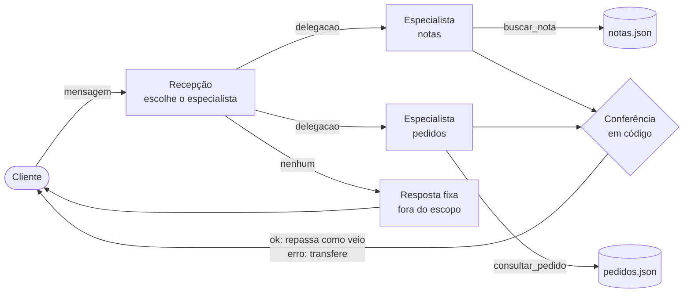

# Sala dos Agentes · back-end


Agentes de IA **reais**, em Python, que trabalham dentro da **Sala dos Agentes**: uma sala isométrica em pixel art onde cada agente trabalha à vista.

O front-end (a sala) é do **Douglas Sanabre**. Este repositório é o back-end: os agentes, a orquestração, as ferramentas e o fluxo de eventos ao vivo que faz a sala se mexer.

> Todos os dados são **fictícios** (Loja Exemplo). Nenhum dado real de empresa ou de cliente é usado aqui.

---

## Índice

1. [O que ele faz](#o-que-ele-faz)
2. [Como funciona](#como-funciona)
3. [Decisões de arquitetura](#decisões-de-arquitetura)
4. [O que aprendi construindo](#o-que-aprendi-construindo)
5. [Números medidos](#números-medidos)
6. [Como rodar](#como-rodar)
7. [API](#api)
8. [Contrato de eventos](#contrato-de-eventos)
9. [Estrutura do projeto](#estrutura-do-projeto)
10. [Limitações conhecidas](#limitações-conhecidas)
11. [Próximos passos](#próximos-passos)

---

## O que ele faz

Um atendimento de loja com **uma recepção e dois especialistas**:

| Agente | Papel | Ferramenta |
| --- | --- | --- |
| `recepcao` | Lê a mensagem e escolhe quem atende. Confere a resposta antes de entregar | `encaminhar` |
| `notas` | Entrega a segunda via de nota fiscal, pelo número da nota ou do pedido | `buscar_nota` |
| `pedidos` | Informa situação, rastreio e previsão de entrega | `consultar_pedido` |

Cada passo vira um **evento** transmitido ao vivo (SSE) para o navegador. É isso que a sala anima.

Exemplos reais do comportamento:

- **Falta de dado:** "Me manda minha nota fiscal?" → o agente pede o número em vez de chutar.
- **Memória:** na mensagem seguinte, só "É a 1001" → o agente entende pelo histórico da conversa.
- **Pergunta mista:** "Meu pedido 50001 chegou, mas preciso da nota dele" → a nota é encontrada pelo número do pedido.
- **Erro de digitação:** "pedido 5002" → a ferramenta devolve `nao_encontrado` e o agente pede para conferir, sem inventar um pedido.
- **Fora do escopo:** "Qual o horário da loja?" → resposta fixa, sem acionar especialista.

## Como funciona



Em paralelo, cada passo é emitido como evento e transmitido via **SSE**:

```
cliente_chegou    recepcao                 +0,00 s
delegacao         pedidos                  +1,16 s
ferramenta        pedidos → arquivo   ok   +2,12 s
resposta_agente   pedidos             ok   +3,13 s
conferencia       recepcao            ok   +3,13 s
resposta_cliente  recepcao            ok   +3,13 s
conversa_encerrada                         +3,13 s
```

## Decisões de arquitetura

| Decisão | Por quê |
| --- | --- |
| **Loop de tool use escrito à mão, sem framework** | Entender o mecanismo de verdade: o modelo só *pede* a ferramenta; quem executa, valida e registra é o código. Uma versão em LangGraph está prevista para comparar |
| **Especialista é configuração** (`Agente` com id, descrição, prompt e ferramentas) e o loop é um só (`rodar_agente`) | Acrescentar um especialista não exige copiar código. Um bug corrigido no loop vale para todos |
| **A recepção roteia, não reescreve** | A resposta do especialista chega ao cliente como saiu. Economiza uma chamada ao modelo por conversa e evita trocar um número ou link no caminho |
| **Roteamento sempre estruturado** (`tool_choice: any` + `enum` com os ids e a opção `nenhum`) | "Fora do escopo" é uma escolha explícita e registrada, e não a ausência de uma chamada. O `enum` impede especialistas inexistentes, e o código valida de novo |
| **A lista de especialistas da recepção é montada a partir das `descricao`** | A descrição do agente é exatamente o que o orquestrador lê para delegar. Uma única fonte de verdade |
| **Conferência em código** (status `ok` e texto não vazio) | Conferência real e auditável, sem custo de tokens. Por isso o evento `conferencia` existe |
| **Evento só para o que aconteceu de verdade** | Os eventos que animam a sala são também o trace. Evento inventado é trace mentiroso. Por isso a duração da ferramenta é a real (0–1 ms em dados locais) |
| **Contrato de eventos do front seguido à risca** (Pydantic espelhando o Zod do front) | O back-end se adapta ao contrato que já existe e está testado. `exclude_none` porque o Zod aceita campo ausente, mas recusa `null` |
| **SSE** em vez de WebSocket | O fluxo é só servidor → navegador. SSE é HTTP simples, e o `EventSource` reconecta sozinho |
| **`POST` responde na hora (202) e os agentes rodam em segundo plano** | A sala precisa ver os eventos chegando enquanto os agentes trabalham, e não tudo de uma vez no final |
| **Emissor com destino plugável** | O agente não sabe para onde vai o evento: terminal, fila do SSE ou, no futuro, um banco. Trocar o destino não mexe nos agentes |
| **Modelo econômico (Haiku) em todos os agentes** | Tarefas estreitas e bem descritas. Trocar para um modelo maior só se a taxa de acerto medida pedir |

## O que aprendi construindo

- **A ferramenta vence a instrução.** A nota cancelada às vezes saía como "não pode ser emitida" (errado: ela foi emitida e depois cancelada). Ajustar o prompt reduziu o erro, mas não eliminou. O que resolveu foi a ferramenta devolver o fato pronto: `segunda_via_disponivel: false`.
- **Instrução não substitui ferramenta.** Na pergunta mista, o agente de pedidos inventava um caminho ("acesse sua conta") porque não tinha como buscar a nota. A correção foi dar a ferramenta: `buscar_nota` passou a aceitar o número do pedido.
- **Regra sem escopo vira conflito.** "A resposta precisa conter o link do PDF" valia até para nota sem link. Regras por caso resolveram.
- **Calcule um fato só quando o modelo precisaria adivinhá-lo.** Na nota, sim (`segunda_via_disponivel`). No pedido, a `situacao` já é explícita, então nenhum campo extra.
- **Diagnóstico pelo trace.** Uma rota "errada" na API era o texto padrão `"string"` do `/docs`. O `motivo` da recepção e os tokens subindo +32 por mensagem mostraram isso sem abrir o código.

## Números medidos

Execuções locais com `claude-haiku-4-5-20251001`:

| Métrica | Valor |
| --- | --- |
| Chamadas ao modelo por conversa com ferramenta | 3 (recepção + 2 do especialista) |
| Tokens de entrada da recepção | ~1.020 por mensagem (cresce com o histórico) |
| Tokens de entrada do especialista | ~880 a ~1.150 por chamada |
| Latência total | ~3,5 s, dos quais ~1,4 s são da recepção |
| Fora do escopo | 1 chamada só e resposta fixa |
| Roteamento nas perguntas de teste | 5 de 5 corretas |

## Como rodar

Requisitos: Python 3.12+ e uma chave da API do Claude.

```powershell
git clone https://github.com/Pedrofeliixx/sala-dos-agentes-backend.git
cd sala-dos-agentes-backend
py -m venv .venv
.venv\Scripts\activate
pip install -r requirements.txt
```

Crie o arquivo `.env` na raiz (ele está no `.gitignore` e nunca vai para o repositório). Use o `.env.example` como modelo:

```
ANTHROPIC_API_KEY=sua_chave
ORIGENS_CORS=http://localhost:3000,https://fluxo-agentes.vercel.app
```

**Só no terminal, sem subir o servidor:**

```powershell
py -m app.conversa
```

**Com a API e os eventos ao vivo:**

```powershell
uvicorn app.main:app --reload
```

- http://127.0.0.1:8000/teste → página de teste: mande mensagens e veja os eventos chegando
- http://127.0.0.1:8000/docs → documentação automática da API
- http://127.0.0.1:8000/saude → health check

Para ouvir o SSE pelo terminal (no PowerShell, use `curl.exe`, e não `curl`):

```powershell
curl.exe -N http://127.0.0.1:8000/conversas/ID_DA_CONVERSA/eventos
```

## API

| Método | Rota | O que faz |
| --- | --- | --- |
| `GET` | `/saude` | Status da API e se a chave está configurada (sem expor o valor) |
| `POST` | `/conversas` | Cria uma conversa → `{"conversa": "id"}` (201) |
| `POST` | `/conversas/{id}/mensagens` | Envia `{"texto": "..."}` → 202. Os agentes rodam em segundo plano. 409 se a anterior ainda está em andamento |
| `GET` | `/conversas/{id}/eventos` | **SSE**: os eventos chegam ao vivo, um por um. A conexão fica aberta entre as mensagens |
| `GET` | `/conversas/{id}` | Histórico com os textos. Os eventos não carregam texto de conversa, por regra do contrato |

## Contrato de eventos

Cada evento segue o `EventoSala` definido no front-end (Zod), espelhado aqui em Pydantic (`app/eventos.py`):

```json
{
  "id": "9ebb402583754f9aa8c9334eb1d0b776",
  "andarId": "modelo",
  "ambiente": "homolog",
  "ts": "2026-10-15T18:48:23.471776+00:00",
  "conversa": "7e1e6c818501",
  "tipo": "ferramenta",
  "agente": "notas",
  "ferramenta": "arquivo",
  "status": "ok",
  "duracaoMs": 0
}
```

| `tipo` | Quando |
| --- | --- |
| `cliente_chegou` | Mensagem nova do cliente |
| `delegacao` | A recepção escolhe o especialista (`agente` = quem recebe) |
| `ferramenta` | O especialista usou uma ferramenta (`ferramenta` = objeto da sala, `status`, `duracaoMs`) |
| `resposta_agente` | O especialista terminou |
| `conferencia` | A recepção conferiu a resposta |
| `resposta_cliente` | Resposta entregue (`status`: `ok`, `erro` ou `fora_do_escopo`) |
| `conversa_encerrada` | Fim do ciclo daquela mensagem |

Os eventos não levam conteúdo de conversa nem dado pessoal, só metadados. O id da conversa é aleatório.

## Estrutura do projeto

```
app/
├── main.py            API FastAPI: rotas, SSE, CORS e página de teste
├── sessoes.py         conversas abertas, fila de eventos e histórico
├── conversa.py        fluxo de uma mensagem: recepção → especialista → conferência
├── orquestrador.py    recepção: roteamento estruturado e conferência
├── eventos.py         EventoSala (Pydantic) e Emissor com destino plugável
├── agentes/
│   ├── base.py        dataclass Agente e o loop de tool use genérico
│   ├── notas.py       especialista de notas fiscais (configuração)
│   └── pedidos.py     especialista de pedidos (configuração)
├── tools/
│   ├── notas.py       buscar_nota(numero | pedido)
│   └── pedidos.py     consultar_pedido(numero)
├── dados/             notas.json e pedidos.json (fictícios)
└── pagina_teste.html  página para testar o SSE no navegador
```

## Limitações conhecidas

- Conversas guardadas **na memória do processo**: somem ao reiniciar o servidor. Em produção, iriam para um Redis ou um banco.
- Cada conexão SSE ocupa uma thread, e cada fila entrega um evento a um ouvinte só. Isso basta para a demo, não para muitos usuários.
- O histórico enviado ao modelo é limitado às últimas 10 mensagens, para controlar custo.
- Ainda sem testes automáticos (próximo passo).

## Próximos passos

- [ ] Integração com a sala do front-end (fonte de eventos ao vivo)
- [ ] Rota de eventos por andar, como prevê o contrato do front
- [ ] Testes automáticos: conjunto fixo de perguntas, taxa de acerto do roteamento, custo e latência por conversa
- [ ] Versão em LangGraph para comparar com o loop manual
- [ ] Docker e deploy

---

Feito por **Pedro Vitório** (back-end e agentes), com o Claude como mentor técnico durante a construção. A sala em pixel art é do **Douglas Sanabre** (front-end).